# Procesamiento del Lenguaje Natural

### Tokens, embeddings, Transformers y búsqueda semántica · Inteligencia Artificial 1, FIT - UCU - 2026

<!-- .slide: data-background-color="#ffffff" -->

---

## Hoy

1. ¿Qué es NLP y por qué es difícil?
2. Texto → números: la versión ingenua
3. Tokenización
4. **Embeddings**
5. Atención y Transformers
6. Búsqueda semántica

---

## Un problema para empezar

<div class="small">

Preguntas frecuentes de la facultad:

| # | Pregunta |
|---|---|
| 1 | ¿Cómo restablezco mi contraseña del portal? |
| 2 | ¿Dónde consulto mis calificaciones? |
| 3 | ¿Cómo me inscribo a un examen? |

Un estudiante busca: **"olvidé mi clave"**

</div>

- Palabras en común con la pregunta 1: **ninguna**. Una búsqueda por palabras clave no la encuentra.
- Para nosotros la respuesta es obvia. ¿Cómo hace una computadora para saber que *clave* ≈ *contraseña* y *olvidé* ≈ *restablecer*? <!-- .element: class="fragment" -->

---

## ¿Qué es NLP?

- ¿Por qué es difícil?
- Un poco de historia

<!-- .slide: data-background-color="#4d4d4d" -->

---

## ¿Qué es NLP/PLN?

<div class="cols"><div>

- Rama de la IA centrada en que las máquinas comprendan, procesen y generen lenguaje humano, escrito u oral.
- Dos grandes enfoques:
  - NLU (*Natural Language Understanding*): interpretar intención y significado.
  - NLG (*Natural Language Generation*): producir texto coherente.
- Aplicaciones: clasificar (spam, sentimiento), extraer entidades, buscar, traducir, resumir, asistentes y chatbots.

</div><div class="fig">

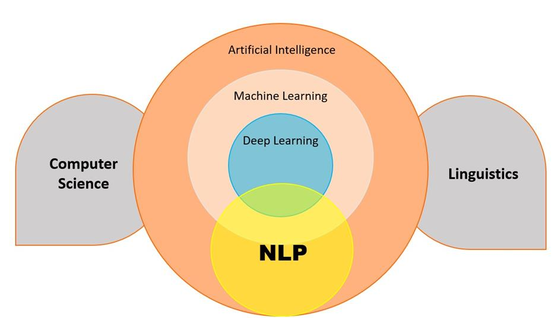

</div></div>

---

## ¿Por qué es difícil?

- **Ambigüedad léxica**: *"banco"* (de plaza, de dinero, de peces, de datos).
- **Ambigüedad sintáctica**: misma oración, distintos árboles.
- **Contexto e ironía**: *"Excelente servicio, solo tardaron tres horas"*.
- **Variación**: errores de tipeo, jerga (*"q onda, ta bien"*), mezcla de idiomas.
- **Conocimiento del mundo**: *"El trofeo no entra en la valija porque es muy grande"*. ¿Qué es grande?

---

## Ambigüedad sintáctica

<div class="cols"><div>

- *"I drink coffee with milk"* vs. *"I drink coffee with friends"*.
- Misma estructura superficial, distinto árbol: ¿*with* modifica a *coffee* o a *drink*?
- Los humanos lo resolvemos sin darnos cuenta, con conocimiento del mundo.

</div><div class="fig">

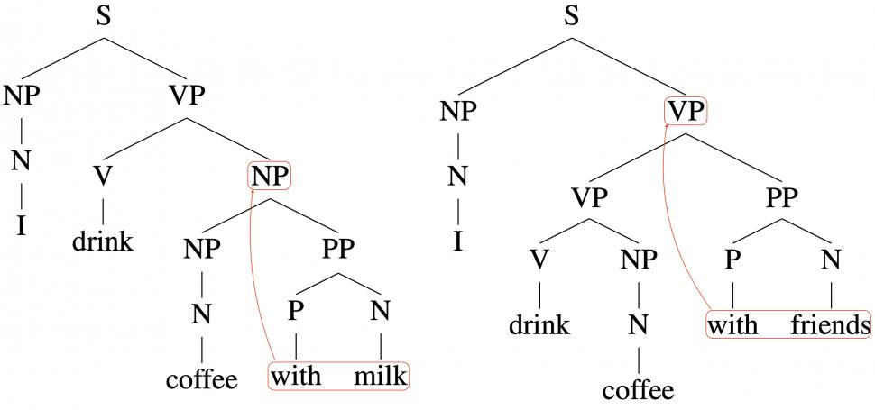

</div></div>

---

## Ejercicio (2')

> *"Vi al hombre con el telescopio."*

- ¿Cuántas interpretaciones tiene? ¿Cuáles?
- ¿Qué información extra la desambigua?

<div class="fragment">

1. Yo usé el telescopio para ver al hombre.
2. El hombre que vi tenía un telescopio.

Sin contexto, ninguna regla gramatical decide por nosotros.

</div>

---

## Historia en una diapositiva

<div class="cols"><div>

- **1950s–80s**: reglas escritas a mano, gramáticas formales.
- **1990s**: estadística sobre corpus (n-gramas, HMM, Naive Bayes).
- **2013–14**: embeddings densos (word2vec, GloVe).
- **2014**: seq2seq con RNN/LSTM, y atención.
- **2017**: Transformer (*Attention Is All You Need*).
- **2018+**: BERT, GPT. **2020+**: LLMs masivos.

</div><div class="fig stack">

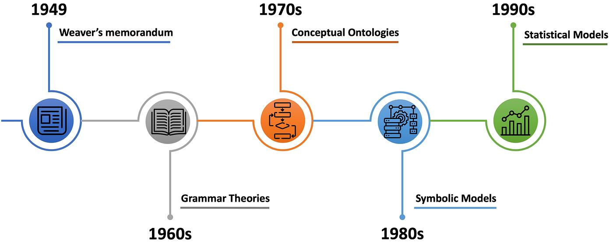

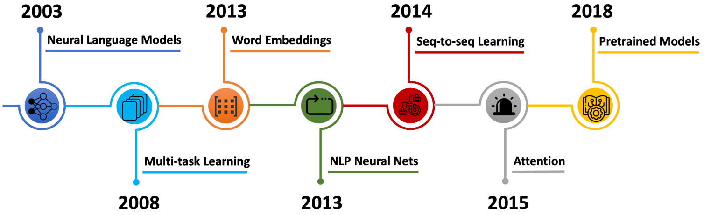

</div></div>

---

## La era de las reglas

<div class="cols"><div>

- Traducción automática temprana: Georgetown-IBM (1954).
- ELIZA (1966, Weizenbaum): imitaba a un terapeuta con patrones de texto. Mucha gente creyó que "entendía".
- Sin aprendizaje: reglas explícitas definidas por humanos.
- Frágil: cada caso nuevo es una regla nueva, y la ambigüedad no escala.

</div><div class="fig">

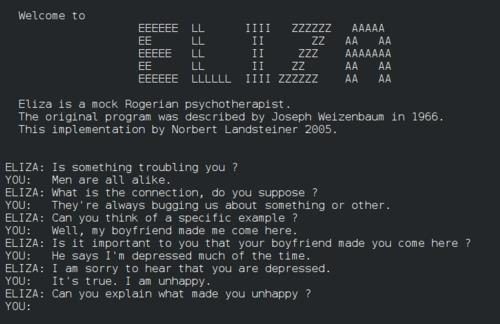

</div></div>

---

## El giro estadístico

<div class="cols"><div>

- Aprender de datos en lugar de escribir reglas.
- **Modelo de lenguaje** de n-gramas: estimar `P(palabra | anteriores)` contando en un corpus.
- Se mide con métricas (Accuracy, F1), como cualquier modelo de ML.
- Problema: la mayoría de los n-gramas nunca aparecen en el corpus, y las palabras siguen siendo **símbolos sin relación entre sí**.

</div><div class="fig">

text = "The Margherita pizza is not bad taste"

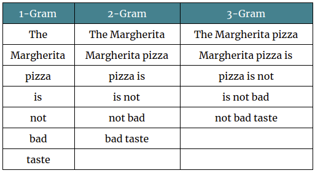

</div></div>

---

## Texto → números

- One-hot y bag of words
- TF-IDF
- Similitud coseno

<!-- .slide: data-background-color="#4d4d4d" -->

---

## El problema de fondo

- Todo lo que vimos en el curso (regresión logística, k-means, PCA, redes neuronales) recibe **vectores de números**.
- Una imagen ya es una matriz de píxeles. Un texto es una secuencia de símbolos.
- Necesitamos una función `texto → vector`.
- La calidad de ese vector define qué tan bien funciona todo lo que viene después.

---

## One-hot

Cada palabra del vocabulario es un vector con un único 1:

<div class="small">

| | el | perro | gato | auto | come | … |
|---|---|---|---|---|---|---|
| perro | 0 | 1 | 0 | 0 | 0 | … |
| gato | 0 | 0 | 1 | 0 | 0 | … |
| auto | 0 | 0 | 0 | 1 | 0 | … |

</div>

- Dimensión = tamaño del vocabulario (decenas o cientos de miles).
- Todos los vectores son **ortogonales**: *perro* está tan lejos de *gato* como de *auto*.

---

## Bag of words (BoW)

Un documento = cuántas veces aparece cada palabra.

<div class="small">

| | el | perro | gato | come | carne | pescado |
|---|---|---|---|---|---|---|
| "el perro come carne" | 1 | 1 | 0 | 1 | 1 | 0 |
| "el gato come pescado" | 1 | 0 | 1 | 1 | 0 | 1 |

</div>

- Simple y sorprendentemente útil para clasificar (spam, temas).
- Pierde el orden: *"el perro mordió al hombre"* = *"el hombre mordió al perro"*.

---

## TF-IDF

Pesar cada palabra según qué tan **informativa** es:

```text
tfidf(t, d) = tf(t, d) · log( N / df(t) )

tf(t, d) : veces que aparece el término t en el documento d
df(t)    : cantidad de documentos que contienen t
N        : cantidad total de documentos
```

- *"el"*, *"de"*, *"que"* aparecen en todos lados, así que pesan casi 0.
- *"contraseña"* aparece en pocos documentos, así que pesa mucho.
- Fue la base de los buscadores durante décadas (y su variante **BM25** se sigue usando).

---

## Similitud coseno

¿Qué tan parecidos son dos vectores? Medimos el **ángulo** entre ellos, no la distancia:

```text
cos(a, b) = (a · b) / (‖a‖ · ‖b‖)
```

- 1: misma dirección (muy parecidos).
- 0: ortogonales (nada en común).
- −1: opuestos (en embeddings densos).
- No depende del largo: un documento largo y uno corto sobre lo mismo dan valores altos.

---

- Abrir el notebook desde la [página del curso](../notebooks/01-sentimiento-tfidf/)
- Completar los `___` y ejecutar las celdas en orden
- Anotar el accuracy: lo vamos a comparar después

# 💻 Manos a la obra

### Notebook 1: Sentimiento con TF-IDF

<!-- .slide: data-background-color="#e3ebff" -->

---

## Límites de la representación ingenua

- **Escasa y enorme**: miles de dimensiones, casi todas en 0.
- **Sin significado**: *auto* y *coche* son tan distintos como *auto* y *banana*.
- **Sin orden ni contexto**.
- Lo vimos en el notebook: *bueno* y *excelente* son columnas sin relación, y una palabra nueva no existe para el modelo.
- Lo que queremos: vectores **chicos y densos** donde **significado parecido ⇒ vectores cercanos**.

Antes de llegar ahí: ¿cuáles son exactamente las "palabras" que vamos a vectorizar?

---

## Tokenización

- Palabras, caracteres o sub-palabras
- BPE
- Tokenizers reales

<!-- .slide: data-background-color="#4d4d4d" -->

---

## ¿Qué es un token?

La unidad mínima que procesa el modelo. Tres opciones:

<div class="small">

| Unidad | Vocabulario | Problema |
|---|---|---|
| Palabras | Enorme (todas las conjugaciones, plurales, typos) | Palabras nuevas o raras son "desconocidas" (`<UNK>`) |
| Caracteres | Mínimo (~100) | Secuencias muy largas, y cada carácter casi no tiene significado |
| **Sub-palabras** | Fijo (30k–200k) | Buen compromiso: palabras frecuentes enteras, raras en pedazos |

</div>

Los modelos modernos (BERT, GPT, etc.) usan sub-palabras.

---

## Del texto al modelo

<div class="cols"><div>

1. **Tokenizar**: partir el texto en tokens.
2. Mapear cada token a un **ID** del vocabulario.
3. Cada ID indexa una fila de una **matriz de embeddings**, y eso es lo que entra a la red.

Un modelo preentrenado solo funciona con **su** tokenizer.

</div><div class="fig">

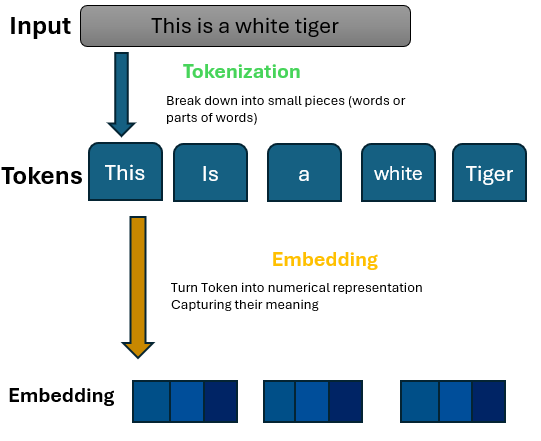

</div></div>

---

## Byte Pair Encoding (BPE)

Algoritmo para **aprender** el vocabulario de sub-palabras a partir de un corpus:

1. Empezar con los caracteres como vocabulario.
2. Contar todos los pares de símbolos adyacentes (ponderando por la frecuencia de cada palabra).
3. Fusionar el par más frecuente en un símbolo nuevo.
4. Repetir hasta llegar al tamaño de vocabulario deseado.

Las sub-palabras frecuentes (*-ando*, *-mente*, *des-*) emergen solas, sin que nadie las defina.

---

## Tokenizers reales

Tokenizer de GPT-4o (`o200k_base`, ~200k tokens):

<div class="small">

```text
"jugando"                         → ['jug', 'ando']
" jugando"                        → [' jugando']        ← ¡el espacio importa!
"Estábamos jugando al fútbol"     → ['Est', 'ábamos', ' jugando', ' al', ' fútbol']
"desafortunadamente"              → ['des', 'af', 'ortun', 'adamente']
"unfortunately"                   → ['un', 'fortunately']
"1234567"                         → ['123', '456', '7']
```

Con el tokenizer anterior (GPT-4, `cl100k_base`), *"Estábamos jugando al fútbol"* son **10** tokens: `'Est', 'áb', 'amos', ' jug', 'ando', ' al', ' f', 'ú', 'tb', 'ol'`.

</div>

---

## ¿Por qué importa?

- **Costo y contexto**: las APIs cobran y limitan por tokens. Con los tokenizers más viejos, el español usaba bastantes más tokens que el inglés para decir lo mismo.
- **Números**: *1234567* se parte en `123 | 456 | 7`, así que hacer aritmética es más difícil de lo que parece.
- **Rarezas**: el modelo "ve" tokens, no letras. Por eso le cuesta contar las *r* de *"ferrocarril"*.
- **Compatibilidad**: el tokenizer es parte del modelo; no se puede cambiar.

---

## ☕ Recreo

### 10 minutos

<!-- .slide: data-background-color="#ffffff" -->

---

## Embeddings

- Hipótesis distribucional
- word2vec y la geometría del significado
- Límites y sesgos
- Embeddings de frases
- ¿Por qué son tan importantes?

<!-- .slide: data-background-color="#4d4d4d" -->

---

## La idea

Reemplazar el one-hot por un vector **denso** y **aprendido**:

<div class="small">

| | one-hot | embedding |
|---|---|---|
| Dimensión | tamaño del vocabulario (~100k) | fija y chica (100–1500) |
| Valores | un 1 y el resto 0 | números reales, todos relevantes |
| *perro* vs *gato* | ortogonales (cos = 0) | cercanos (cos alto) |
| ¿Quién lo define? | nadie: es un índice | se **aprende** de datos |

</div>

Las dimensiones no tienen un nombre interpretable. Lo que importa es la **geometría**: quién está cerca de quién.

---

## Hipótesis distribucional

> *"You shall know a word by the company it keeps."*, J. R. Firth (1957)

<div class="small">

Ejercicio rápido: ¿qué es el *tesgüino*?

- *Un vaso de tesgüino bien frío.*
- *El tesgüino se hace con maíz fermentado.*
- *Tomaron demasiado tesgüino y terminaron mareados.*

</div>

- Nunca nadie les definió la palabra, pero el **contexto** alcanza. <!-- .element: class="fragment" -->
- Palabras que aparecen en contextos parecidos tienen significados parecidos. Eso se puede aprender de texto sin etiquetar. <!-- .element: class="fragment" -->

---

## word2vec (2013)

<div class="cols"><div>

- Tarea "excusa": dada una palabra, **predecir las palabras de su contexto** (ventana de ±k palabras).
- *"…me tomé un **mate** bien caliente…"*: desde *mate*, predecir *tomé*, *bien*, *caliente*.
- Para hacerlo bien, palabras con contextos parecidos necesitan vectores parecidos.
- Los embeddings son un **subproducto** del entrenamiento: la capa de pesos de la red.

</div><div class="fig">

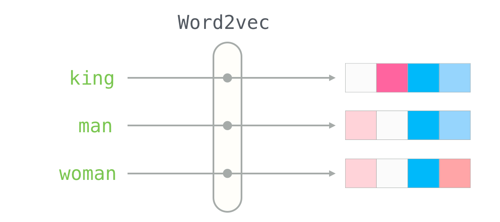

</div></div>

---

## La geometría del significado

<div class="cols"><div>

- Las **direcciones** en el espacio capturan relaciones:

```text
king − man + woman ≈ queen
París − Francia + Italia ≈ Roma
caminando − caminar + nadar ≈ nadando
```

- Género, capital–país, tiempo verbal, comparativos… emergen solos.
- Ojo: es aproximado, y se buscan vecinos **excluyendo** las palabras de la consulta.

</div><div class="fig">

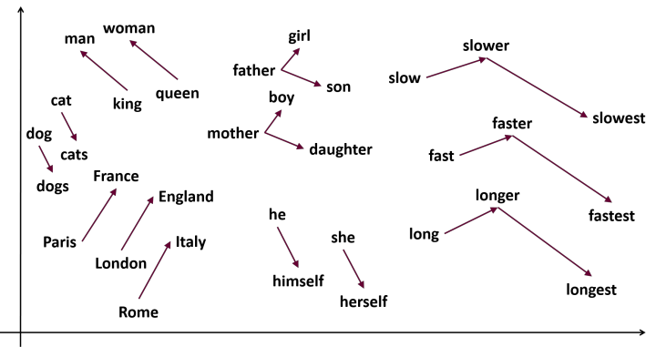

</div></div>

---

## Vecindarios semánticos

<div class="cols"><div>

- Proyectando los embeddings a 2D (PCA, t-SNE, UMAP) aparecen **clusters** temáticos: ciudades, comida, familia, emociones…
- Nadie le dijo al modelo qué palabras son comida. Lo aprendió del contexto.
- Es la misma idea de clustering y PCA que vimos en la clase 4, aplicada a palabras.

</div><div class="fig">

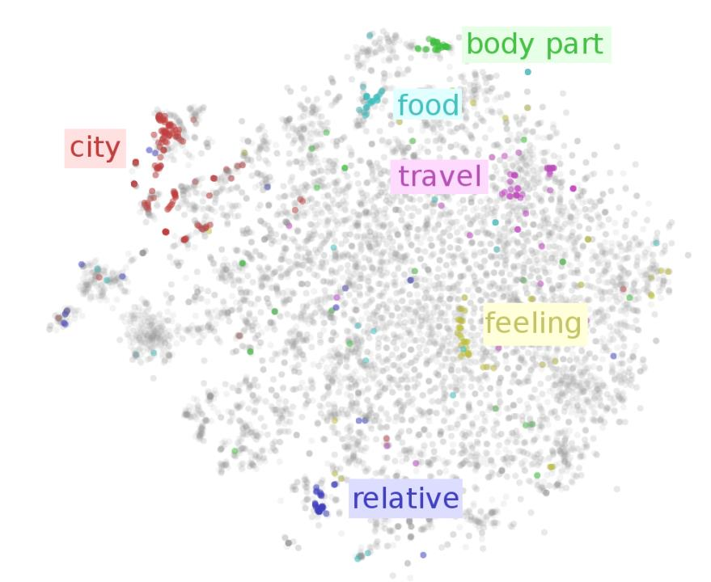

</div></div>

---

## Límite 1: un vector por palabra

word2vec y GloVe son embeddings **estáticos**:

- *"Me senté en el **banco** de la plaza."*
- *"Fui al **banco** a pagar la cuota."*

Ambos *banco* tienen **exactamente el mismo vector**: un promedio de todos sus significados.

Para resolverlo, el vector de una palabra tiene que depender de las palabras que la rodean. Lo resuelven los Transformers.

---

## Límite 2: sesgos

- Los embeddings aprenden **lo que dice el corpus**, incluidos sus estereotipos.
- Bolukbasi et al. (2016), sobre word2vec entrenado con Google News:

```text
man : computer programmer  ::  woman : homemaker
```

- Un buscador de CVs o un clasificador construido sobre esos vectores **hereda el sesgo** sin que nadie lo programe.
- Los modelos actuales también los tienen, aunque más sutiles.

**Discusión (3')**: ¿dónde podría hacer daño un sesgo así? ¿Quién es responsable?

---

## De palabras a frases (y más)

<div class="cols"><div>

- Para buscar o clasificar documentos necesitamos **un vector por frase o documento**.
- Promediar los vectores de las palabras funciona, pero pierde orden y negaciones.
- **Sentence embeddings** (Sentence-BERT, 2019): modelos entrenados para que frases con el mismo significado queden cerca, aunque no compartan palabras.
- No es solo texto: imágenes, audio y código también. **CLIP** (que vimos con SAM) pone imágenes y texto **en el mismo espacio**.

</div><div class="fig">

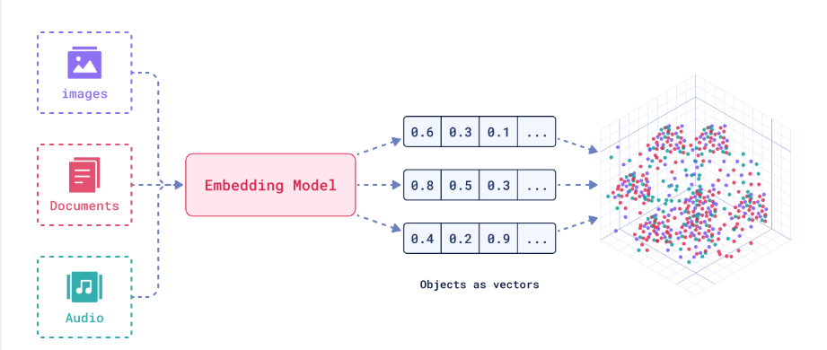

</div></div>

---

## ¿Por qué son tan importantes?

Una vez que el texto es un vector con significado, **todo lo que ya saben hacer** funciona sobre lenguaje:

<div class="small">

| Quiero… | Con embeddings + | Visto en |
|---|---|---|
| Buscar por significado | vecinos más cercanos (coseno) | hoy |
| Agrupar documentos o tickets | k-means | clase 4 |
| Visualizar un corpus | PCA / UMAP | clase 4 |
| Clasificar con pocas etiquetas | regresión logística | clase 3 |
| Detectar duplicados o anomalías | distancia a vecinos | — |
| Darle contexto a un LLM | **RAG** | clase 10 |

</div>

Los embeddings son el **puente** entre datos no estructurados y el machine learning clásico.

---

## Ejercicio: predigan (3')

<div class="small">

Ordenen los pares de **más parecido** a **menos parecido** según un modelo de sentence embeddings:

1. *"El perro persigue la pelota"* / *"Un cachorro corre detrás de la pelota"*
2. *"La película me encantó"* / *"La película no me gustó para nada"*
3. *"El banco subió las tasas de interés"* / *"Me senté en un banco de la plaza"*
4. *"El perro persigue la pelota"* / *"El banco subió las tasas de interés"*

</div>

¿Dónde creen que el modelo los va a sorprender? Lo comprobamos en el notebook 2. <!-- .element: class="fragment" -->

Pista: ¿alcanza con compartir una palabra para que dos frases se parezcan? <!-- .element: class="fragment" -->

---

- Abrir el notebook desde la [página del curso](../notebooks/02-sentimiento-embeddings/)
- Completar los `___` y ejecutar las celdas en orden
- ¿Mejora respecto al notebook 1?

# 💻 Manos a la obra

### Notebook 2: Sentimiento con embeddings

<!-- .slide: data-background-color="#e3ebff" -->

---

## Atención y Transformers

- Antes: RNN y seq2seq
- Self-attention
- Encoder vs decoder
- Embeddings contextuales

<!-- .slide: data-background-color="#4d4d4d" -->

---

## Antes: RNN y seq2seq

<div class="cols"><div>

- Las RNN/LSTM leen el texto **palabra por palabra**, arrastrando un estado.
- seq2seq (2014): un **encoder** resume la frase en un vector y un **decoder** genera la salida (traducción, resumen).
- Problemas:
  - Todo el significado se comprime en **un solo vector**.
  - Las dependencias lejanas se "olvidan".
  - Es secuencial, así que entrenar es lento y no se paraleliza.

</div><div class="fig">

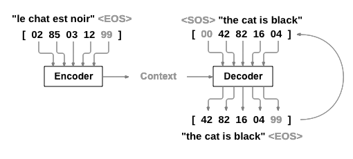

</div></div>

---

## La idea de atención

Cada palabra construye su representación **mirando a las demás** y quedándose con lo relevante:

<div class="fig-below">

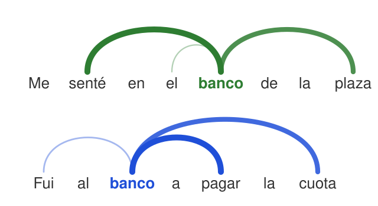

</div>

Mismo token, distinto contexto, **distinto vector**. Esto resuelve el Límite 1.

---

## Self-attention, intuitivamente

Cada token produce tres vectores:

- **Query (Q)**: qué estoy buscando.
- **Key (K)**: qué ofrezco para que me encuentren.
- **Value (V)**: qué información aporto si me eligen.

```text
Attention(Q, K, V) = softmax( Q·Kᵀ / √d ) · V
```

- `Q·Kᵀ`: qué tan relevante es cada token para cada otro (un producto punto, como el coseno).
- `softmax`: lo convierte en pesos que suman 1. Luego se promedian los `V` con esos pesos.
- **Multi-head**: varias atenciones en paralelo, cada una aprende un tipo de relación distinta.
- **Positional encoding**: la atención no ve el orden, así que se le suma la posición a cada token.

---

## El Transformer (2017)

<div class="cols"><div>

- *Attention Is All You Need* (Vaswani et al.): **sin recurrencia**, solo atención y capas densas apiladas.
- Todos los tokens se procesan **en paralelo**, así que se puede entrenar con muchísimos datos en GPUs.
- Cualquier token puede mirar a cualquier otro, sin importar la distancia.
- Es la base de BERT, GPT, T5, Llama, Claude, etc. También de modelos de visión (ViT) y multimodales.

</div><div class="fig stack">

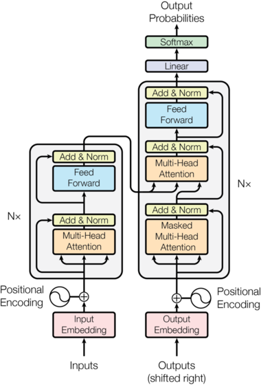

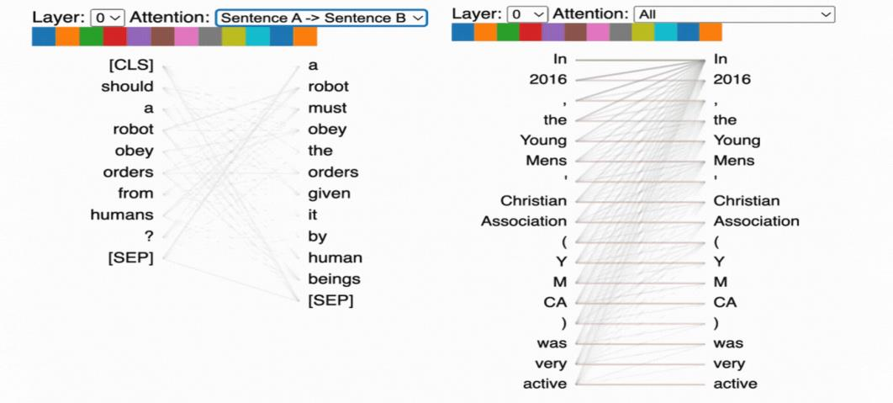

</div></div>

---

## Encoder vs decoder

<div class="small">

| | Encoder (BERT, 2018) | Decoder (GPT, 2018+) |
|---|---|---|
| Atención | Bidireccional: ve toda la frase | Causal: solo ve lo anterior |
| Preentrenamiento | Adivinar palabras tapadas (`[MASK]`) | Predecir el **siguiente token** |
| Bueno para | **Entender**: embeddings, clasificación, búsqueda | **Generar**: texto, código, chat |

</div>

<div class="fig-below">

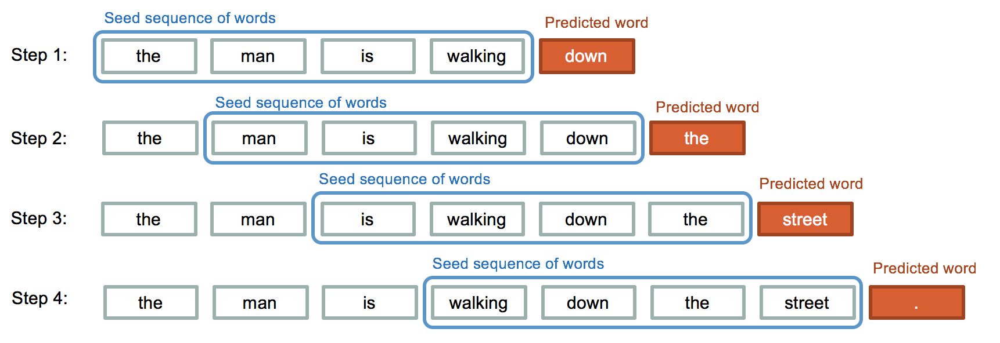

</div>

---

## Embeddings contextuales

- La salida de cada capa del Transformer es un vector **por token, que depende de toda la frase**.
- *banco* (plaza) y *banco* (dinero) ahora tienen vectores distintos.
- Para tener **un vector por frase**: se combinan los vectores de los tokens (p. ej., el promedio) y se entrena para que paráfrasis queden cerca (Sentence-BERT).
- Los modelos de embeddings que usamos en la práctica son, casi siempre, **encoders** de este tipo.

---

## Ejercicio (2')

¿A qué palabra debería prestarle más atención *"estaba"* en cada caso?

- *"El gato no cruzó la calle porque **estaba** muy cansado."*
- *"El gato no cruzó la calle porque **estaba** muy mojada."*

<div class="fragment">

- *cansado* → **gato**. *mojada* → **calle**: la concordancia de género y el conocimiento del mundo deciden.
- Una sola palabra al final de la frase cambia a qué se refiere *estaba*. Para resolverlo hace falta mirar a toda la frase a la vez.

</div>

---

## Búsqueda semántica

- Indexar y consultar
- Léxica vs semántica
- Escalar

<!-- .slide: data-background-color="#4d4d4d" -->

---

## Cómo funciona

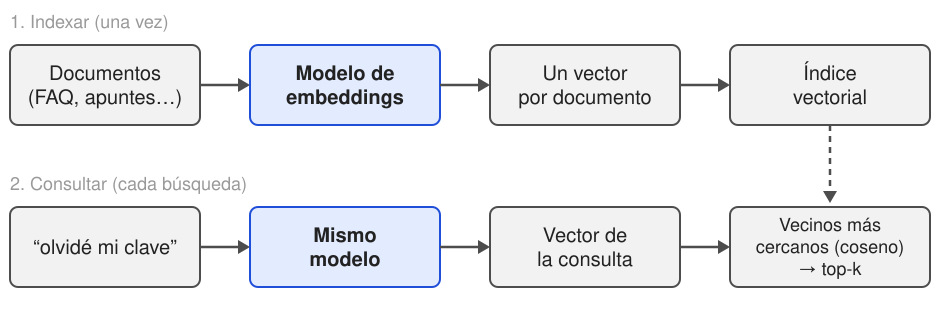

- Documentos y consulta pasan por **el mismo modelo** y quedan en el mismo espacio.
- Buscar = encontrar los vectores más cercanos a la consulta.
- *"olvidé mi clave"* queda cerca de *"¿cómo restablezco mi contraseña?"*, aunque no compartan palabras.

---

## Léxica vs semántica

<div class="small">

| | Léxica (TF-IDF / BM25) | Semántica (embeddings) |
|---|---|---|
| Sinónimos y paráfrasis | ✗ | ✓ |
| Otro idioma (modelos multilingües) | ✗ | ✓ |
| Nombres propios, códigos, números exactos (*"IA-1"*, *"art. 37"*) | ✓ | a veces ✗ |
| Explicar por qué devolvió un resultado | ✓ (palabras en común) | difícil |
| Costo | muy bajo | modelo + vectores |

</div>

En la práctica se usa una **búsqueda híbrida**: se combinan ambos rankings.

---

## ¿Y con millones de documentos?

- Comparar la consulta contra **todos** los vectores es simple y alcanza para miles de documentos.
- Para millones: **búsqueda aproximada de vecinos** (ANN, p. ej. HNSW), que es muchísimo más rápida a cambio de una pequeña pérdida de precisión.
- **Bases de datos vectoriales**: FAISS, Chroma, Qdrant, pgvector (Postgres), etc.
- Elegir el modelo de embeddings importa: idioma, dominio, largo máximo de texto, dimensión.
- Evaluar como cualquier modelo: un conjunto de consultas con sus respuestas correctas, y métricas como *recall@k*.

---

## Resumen

- El lenguaje es ambiguo y depende del contexto. Las reglas no escalan.
- BoW y TF-IDF: vectores escasos, **sin significado**.
- Tokenización: sub-palabras (BPE). El modelo ve tokens, no letras.
- **Embeddings**: vectores densos donde la cercanía es significado. Son el puente hacia todo el ML que ya conocen.
- Atención y Transformers: **embeddings contextuales**.
- Búsqueda semántica = embeddings + vecinos más cercanos.

---

## Lo que viene

- **12/10 (feriado)**: actividad asincrónica de recuperación semántica. Un desafío para ir pensando: encontrar una consulta que la búsqueda léxica falle y la semántica no, y otra al revés.
- **19/10**: LLMs, prompting y **RAG**: búsqueda semántica + un modelo que genera la respuesta con lo que encontró.
