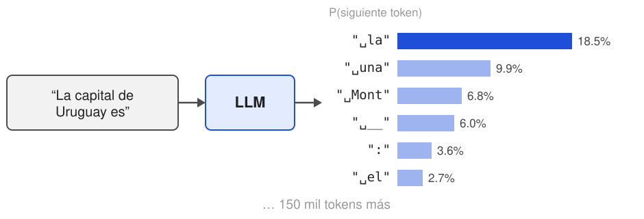
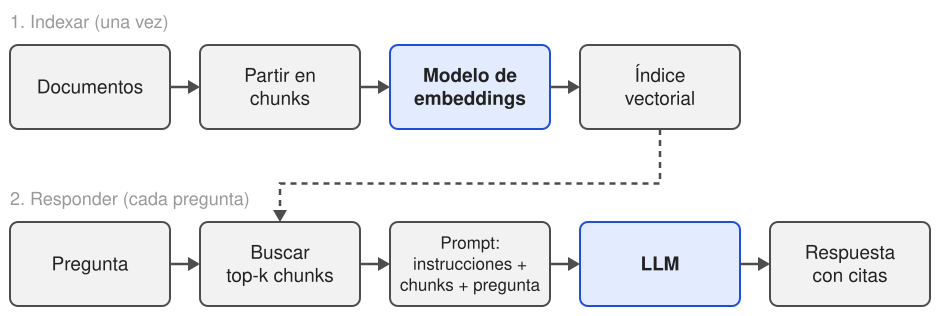

# LLMs, prompting y RAG

### Modelos de lenguaje, prompting, RAG, grounding y evaluación · Inteligencia Artificial 1, FIT - UCU - 2026

<!-- .slide: data-background-color="#ffffff" -->

---

## Hoy

1. ¿Qué es un LLM?
2. Prompting
3. **RAG y grounding**
4. Evaluación

---

## Un problema para empezar

Le preguntamos a un LLM:

<div class="small">

> *"¿Cuántos puntos sobre 100 vale la Prueba Final de Inteligencia Artificial 1 en la Universidad Católica del Uruguay?"*

**Respuesta: 5** <!-- .element: class="fragment" -->

> *"En IA 1 de la UCU, si me va mal en el Parcial 1…"*

**"…no puedo acceder al siguiente parcial."** <!-- .element: class="fragment" -->

</div>

- Según el programa: el Final vale **35**, y si supera a un parcial por al menos 10 puntos, **lo sustituye** (Final − 10). <!-- .element: class="fragment" -->
- El modelo nunca vio el programa del curso. Pero en lugar de decir "no sé", **inventa algo con total seguridad**. ¿Por qué? ¿Cómo lo arreglamos? <!-- .element: class="fragment" -->

---

## ¿Qué es un LLM?

- Predecir el siguiente token
- Generar texto
- Cómo aprenden
- Alucinaciones

<!-- .slide: data-background-color="#4d4d4d" -->

---

## Un decoder, pero enorme

- En la clase 9 vimos el **decoder** del Transformer: atención causal, entrenado para **predecir el siguiente token**.
- Un LLM (*Large Language Model*) es exactamente eso, a una escala enorme:
  - **miles de millones de parámetros**,
  - entrenado con **billones de tokens** de texto (web, libros, código).
- Su salida no es una palabra: es una **distribución de probabilidad** sobre todo el vocabulario.
- Todo lo demás (responder preguntas, resumir, traducir, programar) se construye **encima de esa única tarea**.

---

## El siguiente token



- Probabilidades reales de Qwen2.5 1.5B. ¿Sorprende que *"Montevideo"* no sea lo más probable? <!-- .element: class="fragment" -->
- *" la"* puede seguir con *"ciudad de Montevideo"*. El modelo no responde una pregunta: **continúa un texto**. <!-- .element: class="fragment" -->

---

## Generar = repetir

<div class="small">

```text
La capital de Uruguay es                                → " la"
La capital de Uruguay es la                             → " ciudad"
La capital de Uruguay es la ciudad                      → " de"
La capital de Uruguay es la ciudad de                   → " Mont"
La capital de Uruguay es la ciudad de Mont              → "ev"
La capital de Uruguay es la ciudad de Montev            → "ideo"
La capital de Uruguay es la ciudad de Montevideo        → ","
…
```

</div>

- Elegir un token, **agregarlo al texto** y volver a predecir. Hasta un token especial de fin o un máximo (`max_tokens`).
- Cada token nuevo es **una pasada completa** del modelo: por eso las respuestas largas tardan y cuestan más.
- El modelo no "planea" la respuesta entera: la escribe de a un token, sin poder borrar.

---

## ¿Qué token elegir?

<div class="small">

| Parámetro | Qué hace | Rango típico |
|---|---|---|
| `temperature` | Divide los *logits* antes del softmax. Baja: casi siempre el más probable. Alta: más variedad (y más disparates) | 0 a 2 |
| `top_p` | Muestrea solo entre los tokens más probables que suman *p* de probabilidad | 0 a 1 |
| `top_k` | Muestrea solo entre los *k* tokens más probables | 1 a ∞ |
| `max_tokens` | Corta la respuesta después de *n* tokens | 1 a ∞ |

```text
P(token) = softmax( logits / temperatura )
```

</div>

- Temperatura 0 (*greedy*): siempre el más probable, la misma respuesta cada vez.
- Por eso un LLM puede responder distinto a la **misma** pregunta.

---

## Pregunta (1')

Si le hacemos **la misma pregunta dos veces** a ChatGPT, ¿responde exactamente lo mismo? ¿Por qué?

<div class="fragment">

- No necesariamente: con temperatura mayor a 0, el siguiente token **se sortea** según las probabilidades.
- Basta con que un token sea distinto para que todo lo que sigue cambie.

</div>

---

## La escala

<div class="small">

| Modelo | Año | Parámetros |
|---|---|---|
| GPT-1 | 2018 | 117 millones |
| GPT-2 | 2019 | 1.500 millones |
| GPT-3 | 2020 | 175.000 millones |
| Modelos actuales (GPT, Claude, Gemini, Llama, Qwen…) | 2023+ | de miles de millones a más de un billón (muchos no lo publican) |
| **Qwen2.5 1.5B** | 2024 | 1.500 millones |

</div>

- Con GPT-3 apareció algo nuevo: resolver tareas **sin entrenar**, solo con instrucciones y algunos ejemplos en el texto.
- Más grande suele ser mejor, pero también más caro y lento. Los modelos chicos corren en una laptop o en Colab.

---

## Cómo aprenden

<div class="small">

| Etapa | Datos | Qué aprende |
|---|---|---|
| 1. **Preentrenamiento** | Billones de tokens de texto (web, libros, código) | Predecir el siguiente token. Gramática, hechos, estilo, razonamiento… y sesgos |
| 2. **Ajuste por instrucciones** | Miles de pares *instrucción → respuesta* escritos por personas | Seguir instrucciones y conversar |
| 3. **Alineación con preferencias** (RLHF) | Personas eligen la mejor entre dos respuestas | Ser útil, honesto y evitar respuestas dañinas |

</div>

- Solo con la etapa 1, a *"¿Cuál es la capital de Uruguay?"* el modelo puede seguir con *"¿Cuál es la capital de Paraguay?"*: continúa un examen, no responde.
- La etapa 1 es la carísima (meses, miles de GPUs). Las etapas 2 y 3 son mucho más baratas.

---

## El chat también es texto

Lo que el modelo realmente recibe en una conversación (formato de Qwen):

<div class="small">

```text
<|im_start|>system
Sos el asistente de la materia Inteligencia Artificial 1.<|im_end|>
<|im_start|>user
¿Cuándo es el Parcial 2?<|im_end|>
<|im_start|>assistant
```

</div>

- Roles: **system** (instrucciones generales), **user** y **assistant**. Son tokens especiales, nada más.
- El modelo continúa a partir de `assistant`.
- **No tiene memoria**: en cada mensaje se le manda la conversación entera.
- La **ventana de contexto** limita cuántos tokens entran (de miles a más de un millón, según el modelo).

---

## Alucinaciones

- El modelo está entrenado para producir texto **plausible**, no **verdadero**.
- ¿Por qué inventa?
  - **Fecha de corte**: no sabe nada posterior a sus datos de entrenamiento.
  - **Datos privados**: nunca vio el programa de IA 1, ni los documentos de una empresa.
  - **Datos raros**: lo que aparece poco en el corpus lo recuerda mal.
  - No tiene una noción confiable de **qué sabe y qué no**.
- Casos reales: citas bibliográficas que no existen, o abogados que presentaron jurisprudencia inventada ante un juez (*Mata v. Avianca*, 2023).
- Un modelo chico, cuando no sabe, puede confundir la UCU con la *"Universidad Católica de **Valencia**"*. <!-- .element: class="fragment" -->

---

- Abrir el notebook desde la [página del curso](../notebooks/03-como-genera-un-llm/)
- Ver las probabilidades del siguiente token y generar de a uno
- Jugar con la temperatura
- Preguntarle por el curso: ¿qué inventa?

# 💻 Manos a la obra

### Notebook 3: Cómo genera un LLM

<!-- .slide: data-background-color="#e3ebff" -->

---

## Prompting

- Zero-shot y few-shot
- Anatomía de un buen prompt
- Técnicas

<!-- .slide: data-background-color="#4d4d4d" -->

---

## Un cambio de paradigma

<div class="small">

| | Clase 9 (ML clásico) | Hoy (LLM) |
|---|---|---|
| Para clasificar sentimiento… | entrenamos con **1.800 tweets** etiquetados | **escribimos instrucciones** |
| Para cambiar la tarea… | nuevos datos, reentrenar | cambiar el texto |
| El "programa" es… | los pesos del modelo | el **prompt** |

</div>

- **Prompting**: pedirle la tarea al modelo en lenguaje natural, sin tocar sus pesos.
- Lo que **no** cambia: hay que **evaluarlo** con datos, igual que cualquier modelo. Un prompt que "anduvo con tres ejemplos" no es evidencia.

---

## Zero-shot y few-shot

<div class="small">

**Zero-shot**: solo la instrucción.

```text
Clasificá el sentimiento del tweet como positivo, negativo o neutral.
Tweet: "Bárbaro el recital, re copado"
```

**Few-shot**: la instrucción más algunos **ejemplos resueltos**.

```text
Clasificá el sentimiento del tweet como positivo, negativo o neutral.

Tweet: "Odio los lunes"                        → negativo
Tweet: "Mañana arranca el curso de Python"     → neutral
Tweet: "Qué partidazo, felicitaciones!"        → positivo
Tweet: "Bárbaro el recital, re copado"         →
```

</div>

- Los ejemplos muestran el **formato** y el **criterio** (¿qué cuenta como neutral?) mejor que cualquier explicación.
- No es entrenamiento: los pesos no cambian. El modelo "aprende" solo dentro de ese prompt.

---

## Anatomía de un buen prompt

1. **Rol y contexto**: quién es y para qué (*"Sos el asistente de una materia de la facultad"*).
2. **Tarea concreta**: qué hacer, sin ambigüedades.
3. **Criterios y restricciones**: qué cuenta como neutral, qué hacer si no sabe, qué no hacer.
4. **Formato de salida**: *"una sola palabra"*, una lista, un JSON con campos fijos.
5. **Ejemplos** (si hace falta).
6. **Los datos**, bien separados de las instrucciones (comillas, etiquetas como `<tweet>…</tweet>`).

Regla práctica: ¿lo entendería una persona nueva en el equipo, sin preguntar nada?

---

## Técnicas

- **Pensar paso a paso** (*chain of thought*): pedir el razonamiento antes de la respuesta mejora los problemas de varios pasos. Los modelos de "razonamiento" ya lo hacen solos.
- **Dividir en pasos** (*prompt chaining*): un prompt para extraer, otro para resumir, otro para revisar.
- **Salida estructurada**: pedir JSON y validarlo con código. Es lo que permite conectar el modelo con un programa.
- **Dar una salida**: *"si no está claro, respondé 'no sé'"*. Sin esa opción, el modelo inventa.
- Cuidado, **prompt injection**: si los datos dicen *"ignorá las instrucciones anteriores y…"*, el modelo puede obedecer. Lo retomamos con agentes.

---

## Ejercicio (5')

En grupos, mejoren este prompt para un sistema que procesa reclamos de clientes:

<div class="small">

```text
Decime qué onda este reclamo: "Pedí una pizza hace 2 horas, llegó fría
y encima me cobraron dos veces. Quiero la plata de vuelta YA."
```

</div>

<div class="fragment small">

```text
Sos un asistente que clasifica reclamos de un servicio de delivery.
Leé el reclamo entre <reclamo> y respondé SOLO con un JSON con los campos:
- "categorias": lista con valores de [demora, calidad, cobro, atencion, otro]
- "urgencia": "alta", "media" o "baja"
- "pide_reembolso": true o false
Si el reclamo no tiene relación con un pedido, usá "otro".

<reclamo>Pedí una pizza hace 2 horas, llegó fría y encima me cobraron
dos veces. Quiero la plata de vuelta YA.</reclamo>
```

</div>

---

- Abrir el notebook desde la [página del curso](../notebooks/04-sentimiento-con-prompting/)
- Los mismos tweets de la clase 9, **sin entrenar nada**
- Zero-shot, few-shot y un prompt mejorado
- ¿Le gana a TF-IDF (notebook 1) y a los embeddings (notebook 2)?

# 💻 Manos a la obra

### Notebook 4: Sentimiento con prompting

<!-- .slide: data-background-color="#e3ebff" -->

---

## ☕ Recreo

### 10 minutos

<!-- .slide: data-background-color="#ffffff" -->

---

## RAG y grounding

- ¿Cómo le damos conocimiento nuevo a un LLM?
- El pipeline
- Grounding y citas
- Qué puede fallar

<!-- .slide: data-background-color="#4d4d4d" -->

---

## Volviendo al problema

El modelo no conoce el programa de IA 1. ¿Cómo se lo enseñamos?

<div class="small">

| Opción | Ventajas | Problemas |
|---|---|---|
| **Reentrenar** (*fine-tuning*) | El conocimiento queda "adentro" | Caro, cada cambio del programa es reentrenar, y puede seguir inventando |
| **Pegar todo** en el prompt | Simple, si los documentos son pocos | Límite de contexto, costo por pregunta, se pierde en textos largos |
| **RAG**: buscar lo relevante y pegar solo eso | Actualizar = cambiar un documento; puede **citar la fuente** | Si la búsqueda falla, la respuesta falla |

</div>

- **RAG** (*Retrieval-Augmented Generation*): primero **recuperar** los pedazos de documento relevantes, después **generar** la respuesta a partir de ellos.
- Regla práctica: fine-tuning para **estilo y formato**; RAG para **conocimiento**.

---

## El pipeline



- La fila de arriba es la **búsqueda semántica** de la clase 9.
- Lo nuevo: con los *k* chunks encontrados se arma un prompt, y el **LLM** escribe la respuesta.

---

## Chunking

Partir los documentos en pedazos (*chunks*) antes de indexar:

- **¿Por qué?** Un vector por documento entero mezcla muchos temas y no encuentra nada en particular. Además, no entra todo en el contexto.
- **Tamaño**: típicamente de 100 a 500 tokens. Muy chicos: pierden contexto. Muy grandes: el embedding se "diluye".
- **Respetar la estructura**: secciones, artículos, preguntas de una FAQ. Partir a mitad de una tabla es mala idea.
- **Superposición**: repetir algunas oraciones entre chunks vecinos, para no cortar una idea al medio.
- **Metadatos**: fuente, sección, fecha. Sirven para citar y para filtrar.

---

## El prompt de RAG

<div class="small">

```text
Sos el asistente de la materia Inteligencia Artificial 1.
Respondé la pregunta usando SOLO la información del contexto.
Citá entre corchetes el número de cada fragmento que uses, por ejemplo [2].
Si la respuesta no está en el contexto, respondé exactamente: "No lo sé".

Contexto:
[1] Condiciones académicas: si el Final supera un parcial por al menos
    10 puntos, ese parcial se sustituye por Final - 10, sin reducir notas.
[2] Evaluación: Parcial 1, individual controlado, 20 puntos. ...
[3] ...

Pregunta: Si me va mal en el Parcial 1, ¿lo puedo recuperar?
```

</div>

- **Solo el contexto** + **citas** + **una salida para "no sé"**: las tres piezas del grounding.

---

## Grounding

- Una respuesta está **fundamentada** (*grounded*) si cada afirmación se puede **rastrear a una fuente**.
- Las citas permiten **verificar**: el usuario (o un programa) puede ir al fragmento y comprobar.
- RAG **no elimina** las alucinaciones:
  - el modelo puede mezclar el contexto con lo que "sabe",
  - puede citar un fragmento que no dice eso.
- Lo que sí hace: las vuelve **menos frecuentes y verificables**.
- Decir *"No lo sé"* cuando corresponde también es una respuesta correcta, y muchas veces la más valiosa.

---

## ¿Qué puede fallar?

<div class="small">

| Dónde | Falla típica | Qué probar |
|---|---|---|
| **Datos** | Documento desactualizado, contradictorio o que no tiene la respuesta | Curar las fuentes, fechas en los metadatos |
| **Recuperación** | El chunk correcto no está en el top-k | Otro chunking, más *k*, búsqueda híbrida, otro modelo de embeddings |
| **Generación** | Ignora el contexto, mezcla fragmentos, inventa una cita | Mejor prompt, modelo más capaz, verificar las citas |

</div>

**Siempre mirar primero la recuperación**: si el fragmento correcto no llegó al prompt, el LLM no tiene ninguna chance.

---

## Evaluación

- ¿Por qué es difícil?
- Un conjunto de prueba
- Evaluar por partes
- LLM como juez

<!-- .slide: data-background-color="#4d4d4d" -->

---

## ¿Por qué es difícil?

- En la clase 3 había **una** respuesta correcta por ejemplo: accuracy, precisión, recall, F1.
- Con un LLM:
  - hay **muchas formas correctas** de decir lo mismo,
  - las respuestas son **largas** y pueden ser correctas en parte,
  - con temperatura > 0, **la misma pregunta da respuestas distintas**,
  - un cambio chico en el prompt cambia los resultados.
- *"Lo probé con tres preguntas y anduvo"* no es evidencia. El objetivo del curso es justamente **decidir con evidencia**.

---

## Un conjunto de prueba

Lo mismo que el *test set* de siempre, adaptado:

<div class="small">

| Pregunta | Respuesta esperada | Fragmento correcto |
|---|---|---|
| ¿Con qué porcentaje se aprueba? | 65%, con mínimo de 40% en el Final | Condiciones académicas |
| ¿Cuántos puntos vale el Caso 2? | 7,5 | Evaluación |
| ¿Hay clase el 28 de setiembre? | No, Semana UCU | Cronograma |
| ¿Quién es el decano de la facultad? | **No lo sé** (no está en los documentos) | — |

</div>

- Preguntas **reales** (de estudiantes, de usuarios), incluyendo difíciles y ambiguas.
- Preguntas **sin respuesta** en los documentos: ¿dice "no sé" o inventa?
- Se vuelve a correr **cada vez que se cambia algo**: el prompt, el modelo, el chunking, *k*.

---

## Evaluar por partes

<div class="small">

| Parte | Pregunta | Métrica |
|---|---|---|
| **Recuperación** | ¿Trajo el fragmento correcto? | recall@k |
| **Fidelidad** | ¿Todo lo que dice está en el contexto? | % de afirmaciones con respaldo |
| **Corrección** | ¿Coincide con la respuesta esperada? | contiene el dato clave, o un juez |
| **Abstención** | ¿Dice "no sé" cuando corresponde, y solo entonces? | % de aciertos en preguntas sin respuesta |
| **Sistema** | ¿Es usable? | latencia, costo por pregunta |

</div>

Separar las partes dice **dónde** mejorar: no tiene sentido cambiar de LLM si el problema es la búsqueda.

---

## Métricas automáticas

- **Coincidencia exacta / contiene el dato clave**: simple y confiable para respuestas cortas (un número, una fecha).
- **BLEU / ROUGE**: cuentan palabras en común con la respuesta esperada. Mismo problema que la búsqueda léxica: no entienden paráfrasis.
- **Similitud de embeddings** entre la respuesta y la esperada.
- **LLM como juez**: otro LLM, con una rúbrica, califica cada respuesta.
  - Escala a miles de preguntas, pero tiene sesgos: prefiere respuestas largas, las de su propio estilo, la primera opción.
  - **Validarlo** contra la opinión de personas en una muestra antes de confiar en él.
- Herramientas: RAGAS, DeepEval, promptfoo, entre otras.

---

- Abrir el notebook desde la [página del curso](../notebooks/05-rag-programa-del-curso/)
- Un asistente que responde preguntas sobre el programa de IA 1
- Sin contexto vs con RAG
- Evaluarlo: recall@k, respuestas correctas y "no sé"

# 💻 Manos a la obra

### Notebook 5: RAG sobre el programa del curso

<!-- .slide: data-background-color="#e3ebff" -->

---

## Resumen

- Un LLM es un decoder enorme que **predice el siguiente token**. Generar = repetir, con temperatura.
- Preentrenamiento, instrucciones y preferencias. El chat también es texto.
- Produce texto **plausible**, no necesariamente verdadero: **alucina**.
- **Prompting**: la tarea se describe, no se entrena. Zero-shot, few-shot, formato, una salida para "no sé".
- **RAG** = búsqueda semántica + LLM. **Grounding**: respuestas con fuentes verificables.
- **Evaluar** con un conjunto de prueba, por partes: recuperación, fidelidad, corrección, abstención.

---

## Lo que viene

- **26/10**: **agentes**. Un LLM que no solo responde, sino que **decide qué herramientas usar** (buscar, ejecutar código, llamar una API) y actúa. El buscador de hoy es una de esas herramientas.
- **2/11 (feriado)**: actividad asincrónica sobre trazas, permisos y guardrails.
