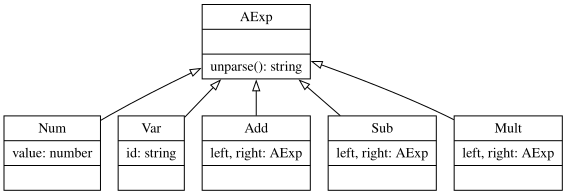
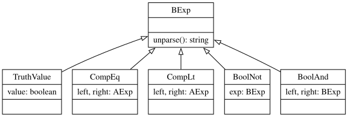
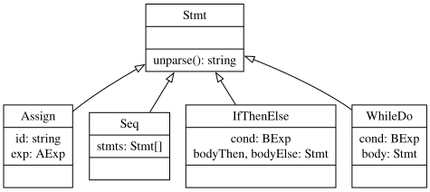

# Interpretación abstracta y transformaciones de código

### Paradigmas de Programación 2, Ingeniería y Licenciatura en Informática, FIT - UCU - 2026

<!-- .slide: data-background-color="#ffffff" -->

---

## Representación de código

- Frontend.
  - Parsing.
  - Abstract syntax trees.

<!-- .slide: data-background-color="#4d4d4d" -->

---

## Especificación del frontend

- Definir una representación de código.
  - Sintaxis abstracta y estructura para el AST.
- Implementar el lexer y parser.
  - Expresiones regulares y gramáticas generativas incontextuales.
  - Herramientas para generar lexers y parsers.

---

## Buena representación intermedia

- Contempla todos los casos del lenguaje.
- Es construible eficazmente a partir de texto.
  - El parser no necesita recorrer varias veces el texto.
  - El parser no necesita manejar información extra.
  - El parser no necesita evaluar el código.
- Permite (y simplifica) los cálculos que se deben hacer sobre ésta.
  - Las recorridas pueden ser eficientes.
  - Las recorridas son cómodas de codificar.
  - Las recorridas no necesitan acarrear muchos datos.

---

## Implementación de AST

- POO.
  - Cada nodo se define en una clase.
  - Las categorías sintácticas se definen con clases abstractas.
  - Cada recorrida del AST se implementa con un método recursivo.
- Visitador.
  - La estructura se define por separado.
  - Cada recorrida del AST se define con un visitador.

---

## AST While OOP <sup>AExp</sup>



```javascript
class Numeral extends AExp {
  constructor(value) {
    this.value = value;
  }
  unparse() {
    const { value } = this;
    return `${value}`;
  }
}
```

---

## AST While OOP <sup>BExp</sup>



```javascript
class CompEq extends BExp {
  constructor(left, right) {
    this.left = left;
    this.right = right;
  }
  unparse() {
    const { left, right } = this;
    return `(${left.unparse()} == ${right.unparse()})`;
  }
}
```

---

## AST While OOP <sup>Stmt</sup>



```javascript
class WhileDo extends Stmt {
  constructor(cond, body) {
    this.cond = cond;
    this.body = body;
  }
  unparse() {
    const { cond, body } = this;
    return `while (${cond.unparse()}) {${body.unparse()}}`;
  }
}
```

---

## AST While: visitor

```javascript
const numeral = (value) => ({ type: 'Numeral', value });
...
const unparse = (ast) => {
  switch (ast.type) {
    case 'Numeral': return `${ast.value}`;
    ...
    case 'CompEq':
      return `(${unparse(ast.left)} == ${unparse(ast.right})`;
    ...
    case 'WhileDo':
      return `while (${unparse(ast.cond}) {${unparse(ast.body}}`;
    ...
    default: throw new Error(`Unknown ast type ${ast.type}!`);
  }
};
```

---

## Ejercicio 1.1: Inferir tipo

- Implementar un chequeador de tipos para expresiones de JavaScript.
  - Literales y variables de tipos: `boolean`, `number` y `string`.
  - Operadores: `+`, `-`, `*`, `/`, `%`, `==`, `!=`, `<`, `>`, `<=`, `>=`, `!`, `&&` y `||`.
- Definir la función `evalType(exp, symbols)`.
  - `exp` es un `string` u objeto *ESTree*.
  - `symbols` es un `Map` de variables en tipos.
- Retorna el tipo esperado la evaluación de la expresión.
  - No usar ni `eval` ni `Function`.
- Este ejercicio se entregará y calificará.

---

## Transformaciones de código

- Generalidades
  - Posible aplicaciones.
- Optimización de código fuente.
  - Análisis estático
  - Transformaciones para optimizar

<!-- .slide: data-background-color="#4d4d4d" -->

---

## Transformación de código

- Es una operación de código (AST) en código (código fuente u objeto).
  - *Desugarizing* y extensión de lenguajes.
  - *Refactoring*.
  - Minimización y ofuscación.
  - Modificación y *weaving* (e.g. aspectos).
  - *Optimización* de código.

---

## Ejemplo 2.1: switch-case con coma

- Se plantea una transformación de código para las sentencias `switch-case`.
  - Casos pueden manejar varios valores separados por comas.

```javascript
switch (x) {
  case 1, 2, 3: return x;
}
// se transforma a
switch (x) {
  case 1:
  case 2:
  case 3: return x;
}
```

- Estudiar y verificar el código provisto por la cátedra.

---

## Optimización de código

- ¿Qué es optimizar código?
  - Modificar el programa para que *ejecute igual pero mejor* (difícilmente óptimo).
  - Código fuente y objeto.
- ¿Por qué se necesita?
  - El programador no puede o no quiere escribir código óptimo.
  - El optimizador ayuda al buen programador.
  - Algunas partes del compilador se simplifican.

---

## Optimización de código <sup>2</sup>

- La optimización *nunca puede modificar trascendentalmente la semántica de un programa en ninguna posible ejecución*.
  - Aún cuando la probabilidad sea baja.
- ¿Qué se puede mejorar?
  - Eliminar cálculos *redundantes*.
  - Eliminar cálculos *superfluos*.
  - Sustituir cálculos equivalentes a otros más eficientes.
  - Sustituir cálculos decidibles en tiempo de compilación.

---

## Pliegue de constantes

- Sustituye expresiones que se pueden realizar en tiempo de compilación por el literal de su resultado.

```c
int segs_dia = 24 * 60 * 60;
// ⇓
int segs_dia = 86400;
```

---

## Pregunta 2.2

- Dado el siguiente código Javascript:
  - `const d = 60 * 60 * 24 * t;`
- ¿Es posible plegar constantes aquí?
  - A. Sí.
  - B. En parte.
  - C. No.
- Contestar vía Webasignatura.
  - ¿Cómo se implementaría el pliegue de constantes?

---

## Propagación de constantes

- Sustituye la referencia a una variable por el valor constante que tiene en toda posible ejecución.

```c
int x = 1; int y = x * 2;
// ⇓
int x = 1; int y = 1 * 2;
```

---

## Pregunta 2.3

- Dado el siguiente código Javascript:
  - `let i = 1; while (i < 0) i = i + 5;`
- ¿Es posible propagar constantes aquí?
  - A. Sí.
  - B. En parte.
  - C. No.
- Contestar vía Webasignatura.

---

## Simplificación algebraica

- Utilizando propiedades de las operaciones, sustituye los cálculos por equivalentes más eficientes.

```c
int x = x + x + x;
// ⇓
int x = 3 * x;
```

---

## Eliminaciones de código

- Código inaccesible que nunca va a ejecutar.

```text
if (false) S1 else S2   ⇒   S2
```

- Código muerto, cuya ejecución no es trascendente.

```text
x = a1; x = a2;   ⇒   x = a2;
```

- Código redundante, que repite cálculos ya hechos y disponibles.

```text
x = a1; y = a1;   ⇒   x = a1; y = x;
```

---

## Pregunta 2.3

- Dado el siguiente código Javascript:
  - `let x = 1; x = y - x + 2;`
- ¿Cuáles optimizaciones se podrían aplicar?
  - A. Pliegue y propagación de constantes.
  - B. Eliminación de código.
  - C. Simplificación algebraica.
  - D. Todas.
- Contestar vía Webasignatura.
  - Luego, ¿cómo quedaría el código optimizado?

---

## Pregunta 2.4

- Dado el siguiente código Javascript:
  - `let i = 1; if (i > 0) i = -i;`
- ¿Cuáles optimizaciones se podrían aplicar?
  - A. Ninguna.
  - B. Pliegue y propagación de constantes.
  - C. Eliminación de código.
  - D. Pliegue y propagación de constantes, y eliminación de código.
- Contestar vía Webasignatura.
  - Luego, ¿cómo quedaría el código optimizado?

---

## Ejercicio 2.5: Optimización de Javascript

- Implementar optimización de código fuente Javascript usando BabelJS.
  - Método `optimize` crea un nuevo AST optimizado.
- Optimizaciones a realizar:
  - Pliegue de constantes.
  - 4 o más simplificaciones algebraicas.
- Este ejercicio se entregará y calificará.

---

## Epílogo

- En esta UT vimos:
  - Interpretación abstracta, con chequeo de tipos.
  - Transformaciones de código, con optimización de código fuente.
- Proxima clase:
  - Lenguajes de consulta.

<!-- .slide: data-background-color="#4d4d4d" -->
